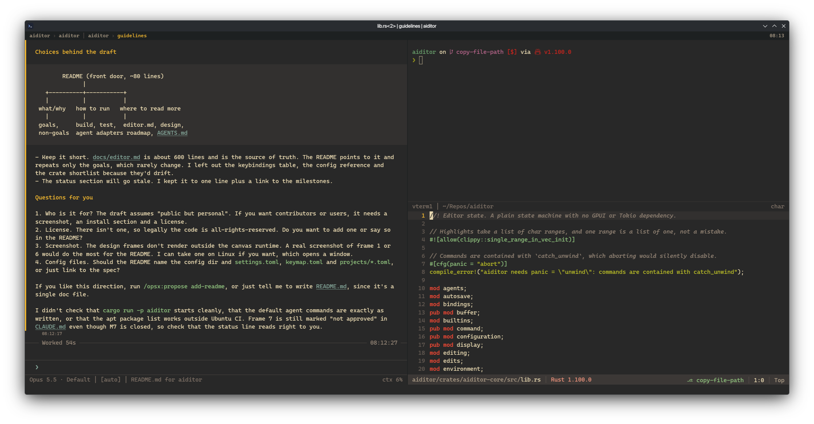

# aiditor

A keyboard-first GUI editor in Rust, built on Emacs's buffer/window model, with Claude Code and
Codex as first-class citizens through the [Agent Client Protocol](https://agentclientprotocol.com).



aiditor is built for one person's daily work and is opinionated accordingly. The code is public
and MIT-licensed, but there are no releases, no support and no stability promises.

## Ideas

- **Everything is a buffer.** Files, terminals, agent sessions and `*Messages*` share one model
  and one window system (`C-x b`, `C-x o`, `C-x 2`, `C-x 3`).
- **Everything is a command.** Keys and `M-x` reach the same named commands.
- **Projects**: a primary repo plus other repos and folders. Find-file, grep and every agent
  session see the same roots.
- **Workspaces**: everything for one task (files, terminals, agent sessions) in its own window
  layout.
- **Agents use their own tools**, scoped to the project. The editor shows what they do: their
  edits revert open buffers, and their commands stream into the session buffer.

Not goals: Elisp, a git UI (git runs in terminal buffers), Windows, plugins, LSP for now.

## Status

M0–M7 are done: editing, projects and workspaces, terminals, agent sessions with resume, the
approved look and the interactive session. M8 (polish) and M9 (diff review) are in progress; see
the [milestones](https://github.com/Root-man/aiditor/milestones).

## Install

macOS is the target; Linux is supported for development. You need the Rust version in
[`.tool-versions`](.tool-versions).

On Linux, install GPUI's system packages first (Debian/Ubuntu names):

```sh
sudo apt-get install libfontconfig-dev libwayland-dev libxkbcommon-x11-dev libx11-xcb-dev
```

On macOS, GPUI compiles Metal shaders at build time; if `xcrun metal --version` fails, run
`xcodebuild -downloadComponent MetalToolchain`.

Then build and install for your user:

```sh
scripts/bundle.sh
```

This installs `~/Applications/aiditor.app` on macOS, and `~/.local/bin/aiditor` with a desktop
entry and icon on Linux.

Agents run through their ACP adapters, which must be on `PATH`: `claude-agent-acp` for Claude
Code, `codex-acp` for Codex (add it to `settings.toml`, see below).

## Configuration

`settings.toml`, `keymap.toml` and `projects/*.toml` in the config dir, all optional and reloaded
with `C-x C-r`. See [docs/configuration.md](docs/configuration.md) for every option.

## Development

```sh
cargo run -p aiditor
cargo test
```

| Crate | What it holds |
| --- | --- |
| `aiditor-core` | All editor state, commands, keymaps and the display model; no GPUI or Tokio (CI checks) |
| `aiditor-services` | Async I/O: agents over ACP, PTYs, file watching, indexing and grep; the `aiditor-fake-agent`, `aiditor-acp-record` and `aiditor-headless` binaries |
| `aiditor` | The GPUI frontend and the app binary |

- [docs/editor.md](docs/editor.md): the spec: goals, architecture, data model, decisions, testing
- [docs/design](docs/design): the approved visual designs
- [docs/roadmap.yaml](docs/roadmap.yaml): milestones and issues
- [docs/performance.md](docs/performance.md): benchmarks
- [AGENTS.md](AGENTS.md): guidance for coding agents working on this repo

## License

[MIT](LICENSE)
