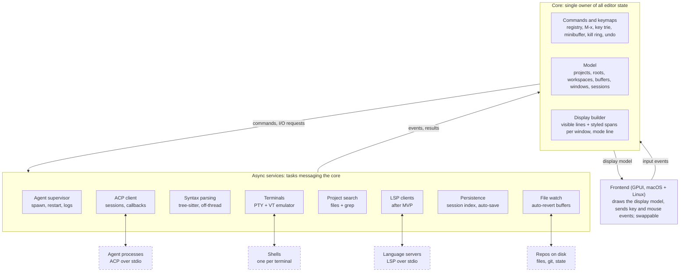

# Editor project — architecture sketch & open questions

Oct 12, 2026 · @Boba · revised Oct 13, 2026

## Goals and principles

Build a personal, keyboard-first GUI editor in Rust, organised around **projects** (a primary repo plus other repos and folders) and **workspaces** (everything for one task), with Emacs's buffer/window model as the interaction core. macOS is the target; development happens on both macOS and Linux, so it must build and run on both. It is a private experiment; if it works, it becomes the editor used for daily work.

**Goals**

- ACP client as a first-class subsystem with built-in session management; Claude Code and Codex from day one.
- Emacs-flavoured keybindings and the Emacs buffer/window model as the default. Exact keys are chosen as each feature is built.
- Projects that group several repos and give every agent session the same filesystem scope.
- Workspaces that hold all the files, terminals and agent sessions for one task.
- Built-in terminal, where a terminal is just another buffer; several per workspace.

**MVP feature set**, mapped from current daily use:

| Today in Emacs | In this editor |
| --- | --- |
| projectile | Project commands: create and edit projects, find file across all roots, switch project, grep the project |
| consult | Minibuffer completion for buffers, files, commands and grep hits, with live preview |
| swiper | In-buffer search that lists matching lines in the minibuffer |
| Buffer and window navigation | `C-x b`, `C-x o`, splits, one window configuration per workspace |
| In-buffer editing | Emacs motion, mark, kill ring, registers, keyboard macros, TAB indentation |
| Formatters | Run the language's formatter (`mix format`, `rustfmt`, prettier) as a command; not on save |
| xref / dumb-jump | Jump to definition by grep across the project, no LSP (spec to be decided) |
| compile-mode / `next-error` | Jump to `file:line` from terminal output, grep hits and agent tool calls (spec to be decided) |
| wgrep | Edit grep results in place and write them back (spec to be decided) |
| Multiple cursors | After MVP |
| dired (rarely used) | After MVP |

Languages with first-class support: Elixir, Rust, JS/TS and Markdown.

**Non-goals**

- Elisp compatibility or running Emacs packages.
- A git UI or Magit replacement. Git runs in terminal buffers, and `git diff` in a terminal is how agent changes are reviewed.
- LSP, multiple cursors and git worktree workflows in the MVP.
- Windows, a TUI frontend, plugins, collaboration, remote editing, more than one frame (OS window).

**Design principles**

1. **Everything is a buffer.** Files, terminals, agent sessions and the message log share one model and one window system.
2. **Everything is a command.** Keys and `M-x` call the same named commands, so every feature is reachable both ways.
3. **Every layer is testable on its own**, and the whole app is testable end to end (see Testing).
4. **One owner of state.** A single-threaded core, running on the UI thread, owns editor state; I/O (agents, PTYs, file watching) and heavy CPU work (grep, fuzzy matching, parsing) run in tasks that talk to it by messages.
5. **Agents use their own tooling, scoped by the project.** The editor gives each agent a working directory and extra roots, then shows what it does: its changes to files that are already open appear in their buffers, and terminals it asks the editor for are terminal buffers.

## Architecture at a glance

Four layers: a thin frontend, one core that owns all state, async services that do I/O, and the outside processes they talk to.



Arrows between layers are message channels, never shared mutable state. Dashed boxes run outside the editor. Agents reach the project through their own tools, scoped by `cwd` and the extra roots; there is no editor-side MCP server. The core runs on the UI thread, inside the frontend's event loop; see [Core thread and output floods](#core-thread-and-output-floods).

## Core data model

A project defines the filesystem scope; a workspace is the unit of work inside it. Every workspace belongs to exactly one project, and every buffer, terminals and agent sessions included, belongs to exactly one workspace, except the global `*Messages*` buffer (see Workspaces).

| Entity | What it is | Owns / refers to | Survives restart |
| --- | --- | --- | --- |
| Project | A primary repo plus additional repos and folders | Roots, workspaces, default agent | Yes, a TOML file in the editor's config dir, outside the repos |
| Primary repo | The root whose agent config is used: AGENTS.md, CLAUDE.md, MCP server list, agent settings | Path, role line | In the project file |
| Additional root | Another repo or folder the agent gets filesystem access to | Path, role line | In the project file |
| Workspace | Everything for one task, tied to one project | Window configuration, its buffers (files, terminals, agent sessions) | No |
| Buffer | Content plus metadata, independent of any window, owned by one workspace | Content backend, undo history, major and minor modes, markers, text properties (face, invisible with a placeholder, line decoration), file binding or kind | No (auto-save files aside, see Crash safety) |
| Buffer kind | File, Terminal, AgentSession, Messages, Scratch | Kind-specific payload (PTY handle, session id) | No |
| Window | A viewport onto one buffer | Buffer id, point, mark, scroll position | No |
| Window configuration | Split tree of windows (`C-x 2` / `C-x 3`) | Windows, split ratios, selected window | No |
| Frame | The app's single OS window | Shows one workspace at a time | No |
| Agent session | One ACP conversation with one agent process | Agent, project, ACP session id, mode | Index entry only: enough to reload it with `session/load` |

A buffer never knows which windows show it, and a window holds only a buffer id. That separation keeps `C-x b`, `C-x 4 b` and per-workspace window configurations cheap.

A window's point and mark are markers in its buffer, so edits made elsewhere move them. Its first visible line moves only as far as needed to keep point's line on screen; the core does that at redisplay, given the rows the frontend can show.

Buffers have more than one content backend: a rope for file, scratch and Messages buffers, the emulator grid for terminals, and a structured transcript for agent sessions, which the core renders into a rope (see Session buffer under ACP integration).

Each workspace owns its buffers, and a buffer belongs to exactly one workspace, `*Messages*` excepted. Killing a workspace kills its buffers. The same file can have several buffers: a file open in two workspaces has two, kept in sync through the disk. When the file changes on disk (a save from the other workspace, an agent's edit, a `git checkout` in a terminal), every buffer visiting it reverts automatically. The watcher reports every change, the editor's own saves included, and each buffer compares the new disk hash with its own: the buffer that saved sees no change, and the other buffers of that file revert.

If the file changes on disk while its buffer has unsaved edits, the editor does not revert. It marks the buffer as conflicted, shows that in the mode line, and asks you to resolve it the next time you focus the buffer or try to save it. The choices are:

- **Keep mine**: overwrite the disk version on save.
- **Take disk**: revert to the disk version; your unsaved text stays in undo history.
- **Compare**: open a diff of buffer against disk and merge by hand.

Every save also checks the file's hash on disk against the last version the buffer loaded or saved, so a change the watcher missed is still caught before it can be overwritten.

**File handling** (decided in [#45](https://github.com/Root-man/aiditor/issues/45)), with Emacs's defaults where they fit:

- **Encoding.** UTF-8 only. A UTF-8 byte-order mark is kept: stripped on load, written back on save. Other encodings come in M5 ([#155](https://github.com/Root-man/aiditor/issues/155): detect with `encoding_rs`, write back in the original encoding).
- **Line endings.** The first line break in the file sets its ending, LF or CRLF; a file without one is LF. The buffer always holds LF, a save writes the file's ending back, and the mode line shows `(DOS)` for CRLF files.
- **Final newline.** A save adds a newline when the text doesn't end with one, as Emacs's text and prog modes do (`require-final-newline`).
- **Binary files.** A file with a NUL byte in its first 8 KB, or one that isn't valid UTF-8, is refused with the reason in the echo area. A file named on the command line opens as an empty read-only buffer instead, so the app still starts.
- **Saving.** Saves are atomic: write a temp file in the same directory as the target and rename it over the target, after copying the old file's mode to the temp file. A symlink is followed and its target replaced, never the link itself. A file with more than one hard link, or a directory where the rename isn't allowed, is written in place instead, so links stay shared. Owner and group are not copied.
- **Built in [#46](https://github.com/Root-man/aiditor/issues/46).** The file service in `aiditor-services` reads and writes bytes; the core decodes them, and a save encodes the buffer's text snapshot and writes it on Tokio's blocking pool (`files::run`, shared with the headless binary). The hash (FNV-1a 64 of the file's bytes, `buffer::hash`) is taken on load and save; `C-x C-s` refuses with `<path> changed on disk; not saved` when the disk differs, a file that appeared since it was opened as missing included. The final newline is inserted into the buffer, point staying before it. An unmodified buffer is not written (`(No changes need to be saved)`), a finished save says `Wrote <path>`, and a failed one shows its error. Edits made while a save runs stay unsaved. A refused file's empty buffer is read-only: the mode line shows `%%`, and every edit fails with `Buffer is read-only`. The mode line puts `(DOS)` after the buffer name. The in-place fallback is taken only on a permission error, so a full disk fails the save instead of truncating the file. Not yet: a second save while one runs is refused as a change on disk.
- **Built in [#48](https://github.com/Root-man/aiditor/issues/48).** `C-x C-c` (`save-buffers-kill-terminal`) asks `Save file <path>? ` (`Yes`, `No`; typed `yes`, `y` or `no` pick them too) for each modified file buffer, most recent first, then, if any was declined, `Modified buffers exist; exit anyway? ` (`No`, `Yes`); the `Yes` buffers are saved either way, and the app quits once those saves succeed with the buffers unmodified, a failed save cancelling the quit. With nothing modified it quits at once. Closing the window runs the same command instead. Not yet: Emacs's other answers (`!`, `.`, `q`, `d`), quitting from the minibuffer while something is modified, and OS quit paths that skip the window (the Dock's Quit, SIGTERM).
- **Long lines.** Truncated at the window edge in M0, with Emacs's automatic horizontal scroll (`auto-hscroll-mode` set to `current-line`, [#153](https://github.com/Root-man/aiditor/issues/153)): point's line scrolls sideways to keep point visible, and the other lines stay put. Built with Emacs's defaults `hscroll-margin` 0 and `hscroll-step` 0: the line scrolls just far enough to show point, is unscrolled whenever point's column fits the window, and the minibuffer scrolls the same way in the frame's width less its prompt. A column is one char, so tabs and wide chars can still push point past the edge. The cut happens in the display model, which holds only the shown columns (plus one for a partly visible last column), so a long line costs a window's width per redisplay, not its length. Soft wrap comes in M5 ([#112](https://github.com/Root-man/aiditor/issues/112)), Emacs-like: file buffers wrap by default, Markdown and text at word boundaries (`visual-line-mode`), code at the window edge with a continuation marker, and `toggle-truncate-lines` switches a buffer back to truncation.

How a revert keeps point, mark and markers, and several file-watcher edge cases, are still to be decided (see Open questions).

## Projects

A project is a TOML file in the editor's config dir that lists a primary repo and additional roots, each with a one-line role.

- **Commands.** Create a project, add or remove a root, edit a root's role line, set the default agent, open the project file for editing. All available as keys and through `M-x`. (Built in [#58](https://github.com/Root-man/aiditor/issues/58): `project-create` (`C-x p c`), `project-add-root` (`C-x p a`), `project-remove-root` (`C-x p r`), `project-set-role` (`C-x p l`), `project-set-default-agent` (`C-x p d`, empty text removes it), `project-open-file` (`C-x p o`) and `project-save` (`C-x p s`). Every command but create asks first for a project by name (workspaces bind one since #64, but the commands still ask), the first of equal names winning. A directory prompt lists only directories, the one typed first as `./`, and `RET` returns the selected one (`TAB` enters it), so `RET` right away takes the starting directory; a relative one is taken from the buffer's directory and a trailing `/` dropped. An edit is checked as a loaded file is and rewrites the file in place with `toml_edit`, changing only what differs, so comments and layout stay; it is refused, writing nothing, when the file on disk is no longer the text last read or written (`C-x C-r` reloads). Create and save write `projects/<name>.toml`, refusing a taken name, an existing file, and a name with `/` or a leading `.`. An ad-hoc project is edited in memory until `project-save`. Not yet: projects reload when their visited file is saved, so a hand edit needs `C-x C-r`; the role prompt does not start with the current role.)
- **File format** (built in [#56](https://github.com/Root-man/aiditor/issues/56)). Each project is a `*.toml` file in `projects/` under the config dir:

  ```toml
  name = "aiditor"
  default_agent = "claude"        # optional

  [primary]
  path = "/Users/me/Repos/aiditor"
  role = "The editor itself"

  [[roots]]                       # zero or more
  path = "/Users/me/Repos/zed"
  role = "GPUI source, read only" # optional, empty by default
  ```

  Every file is read at launch and again on `C-x C-r`, which replaces the saved projects loaded before; ad-hoc projects stay, since workspaces are bound to them ([#64](https://github.com/Root-man/aiditor/issues/64)). A file is rejected when it is not valid TOML, has an unknown key or a wrong type, an empty name, a path that is not absolute or not a directory, a root that is the same as or inside another root of the project, or a role on more than one line; the echo area and `*Messages*` show `project <file>: <reason>`, and the other files still load. The core parses and checks the text through the settings module; `aiditor-services` lists the files and checks the paths exist. Not yet: `default_agent` is not checked against the agent registry, duplicate names are not caught, and a project's `env` overrides are not read.
- **Roots and folders** (decided in [#57](https://github.com/Root-man/aiditor/issues/57)):
  - **Within one project**, roots never overlap: a root that is the same as or inside another, the primary included, rejects the file with `project <file>: <inner> is inside <outer>`. Find-file, grep and the watchers then see each file once, under one role line. Paths are compared as written, so symlinks and `..` are not resolved.
  - **Across projects**, roots may be shared or overlap (`~/Repos/zed` in several projects): every workspace is bound to one project, so a shared root is never ambiguous, and nothing is checked across files.
  - **A folder without a project** (named on the command line, [#64](https://github.com/Root-man/aiditor/issues/64); an open-folder command was dropped in its review, since the command line and `project-switch` cover it) gets an ad-hoc project held in memory, with the folder as primary and its name as the project name, and a workspace for it. Nothing is written until a save-project command ([#58](https://github.com/Root-man/aiditor/issues/58)) writes it to `projects/`.
- **Launching without a project** (decided in [#189](https://github.com/Root-man/aiditor/issues/189), built in [#64](https://github.com/Root-man/aiditor/issues/64)). Every workspace has a project, so every launch resolves to one, as Emacs's `project-current` does:
  - **A file on the command line** opens in a workspace of the first loaded project one of whose roots contains it. With none, it gets an ad-hoc project at the nearest enclosing git repo (a directory holding `.git`), or at the file's own folder outside any repo, named after that directory as an open folder is.
  - **No argument** gives a workspace on an ad-hoc project whose primary is `$HOME`, with its scratch buffer, whatever the working directory: from the macOS Dock or Finder it is `/`. A welcome dashboard with recent files and projects comes later ([#193](https://github.com/Root-man/aiditor/issues/193)).
  - **Watching and indexing a large project.** The project file gets a `watch` key, on by default and off for the `$HOME` project ([#191](https://github.com/Root-man/aiditor/issues/191)): an unwatched project's file index refreshes on demand only, and saves still catch disk changes by hash. Gitignore-style `ignore` patterns in the project file, a `.ignore` file in a root too, narrow what the index, grep and the watcher see, an allow-list included (`*`, then `!notes/`) ([#190](https://github.com/Root-man/aiditor/issues/190)). A `max_watched_files` setting, overridable per project, refuses to watch a project over the limit and says so, like lsp-mode's `lsp-file-watch-threshold` ([#192](https://github.com/Root-man/aiditor/issues/192)). With patterns, `$HOME` can be narrowed enough to watch.
  - The launch workspace `default`, bound to no project, that [#62](https://github.com/Root-man/aiditor/issues/62) started with went away in #64.
- **Switch project** (decided in [#59](https://github.com/Root-man/aiditor/issues/59), built with the workspace commands in [#64](https://github.com/Root-man/aiditor/issues/64)) prompts for a project with completion, then shows that project's most recently shown workspace, or creates a workspace for it and shows that when it has none. It never asks a second question: another workspace on the same project comes from New workspace.

## Workspaces

A workspace is everything related to one task: its file buffers, terminal buffers and agent sessions, laid out in its own window configuration. Creating a workspace asks for a project, and the workspace stays bound to it.

- **Ownership.** Every buffer belongs to the workspace it was created in. Opening a file that is already open in another workspace creates a second buffer for it here.
- **`*Messages*` is global** (decided in [#61](https://github.com/Root-man/aiditor/issues/61)): one for the app, owned by no workspace, since it collects output from everywhere. Every workspace's buffer list and switcher include it, any workspace's window can show it, and killing a workspace leaves it alone. It is the only global buffer.
- **New workspace.** Starts with one empty scratch buffer.
- **Killing a workspace** kills every buffer it owns, terminals and session buffers included. The agent sessions stay in the session index and can be resumed in another workspace of the same project.
- **Built in [#62](https://github.com/Root-man/aiditor/issues/62)** (the core model; commands come in [#64](https://github.com/Root-man/aiditor/issues/64)). A workspace holds its project by name, since reloads replace the project list. The editor started with one workspace, `default`, bound to no project, until #64 replaced it with the launch rules decided in [#189](https://github.com/Root-man/aiditor/issues/189) (see Projects). Each buffer is owned by the workspace current when it was made, `*Messages*` by none. A file is reused only within the current workspace, so a second workspace gets `a.txt<2>`: buffer names stay unique across workspaces. A new workspace becomes current and shows its `*scratch*` in the selected window. Killing the current workspace makes the one after it current, or the one before when it was last, and the sole workspace can't be killed (`Attempt to delete the sole workspace`). A killed buffer's windows show a buffer of their own workspace (the current one until #63) or `*Messages*`, never another workspace's. `C-x k` refuses `*Messages*` and every workspace's `*scratch*` (`Can't kill <name>`), marked by an `unkillable` buffer flag rather than by name; killing a workspace still kills its scratch. (#64's kill command asks about modified buffers.)
- **Built in [#63](https://github.com/Root-man/aiditor/issues/63).** Each workspace keeps its own window configuration: the split tree, each window's buffer, point, mark and scroll, and the selected window. Switching shows it as it was left, and a new workspace starts with a single window on its `*scratch*`. Windows of a workspace that is not current keep their points and marks as markers, so edits made meanwhile move them. A killed buffer is replaced in every workspace's windows by that workspace's most recent buffer or `*Messages*`. Window ids are unique across workspaces, so a click on a window that is no longer shown is dropped. Switching closes an open minibuffer, cancelling its prompt. The switch commands come in #64.
- **Built in [#64](https://github.com/Root-man/aiditor/issues/64).** The commands live under `C-x t`, Emacs's tab-bar prefix: `workspace-new` (`C-x t 2`) prompts for a project, then a name, refusing a taken one; a blank name names it after the project, `<2>` when taken; `workspace-switch` (`C-x t RET`) lists the others most recently shown first and the current one last, so `RET` alone goes back; `workspace-next` and `workspace-previous` (`C-x t o`, `C-x t O`) cycle in creation order, wrapping, a count moving that many; `workspace-rename` (`C-x t r`) renames the current one, refusing an empty or taken name; `workspace-list` (`C-x t l`) shows `name (project)` for each in the echo area, the current one marked `*`; `workspace-kill-current` (`C-x t 0`, Emacs's `tab-close`) kills the current one and `workspace-kill` (`C-x t k`) asks which, listing the current one first; both refuse the sole workspace before asking anything, then asks `C-x C-c`'s questions about that workspace's modified file buffers only (`Modified buffers exist; kill anyway? `) and kills once the chosen saves succeed. Each workspace's scratch is `*scratch*<name>`, renamed with the workspace, so every scratch name says whose it is (tests pin the launch workspace's name to `main`, since it otherwise follows `$HOME`). `project-switch` (`C-x p p`) shows the project's most recently shown workspace or makes one. A folder on the command line takes the first saved project one of whose roots contains it, else a new ad-hoc project at the folder (named after it, `<2>` when taken). Ad-hoc projects are matched only by their primary, so the `$HOME` project doesn't take every folder. A launch file's git repo is the nearest ancestor holding `.git` (a directory or a worktree's file); the `$HOME` project's "watching off" waits for a watcher. Not yet: an ad-hoc project stays after its last workspace is killed; a reload that drops a saved project leaves its workspaces bound to the missing name; a quit started while a kill waits on its saves takes over the wait.
- **Outside files.** A workspace can open files from outside its project. What the agent may touch is set by the project roots and the session's approval mode, not by what is open.
- **Lifetime.** Workspaces live until killed or until the app quits; they are not restored on the next launch.
- **Switching buffers.** `C-x b` and the consult-style switcher list the current workspace's buffers. (Built in [#66](https://github.com/Root-man/aiditor/issues/66): `C-x b`, `C-x 4 b` and `C-x k` complete over and find only the current workspace's buffers and `*Messages*`. A name only another workspace has counts as new, so `C-x b a.txt` there makes an empty `a.txt<2>` here and `C-x k a.txt` fails with `No such buffer a.txt`. `C-x b`'s completion is the switcher until a consult-style one comes.)
- **Commands.** New workspace (prompts for project), switch, next/previous, rename, kill, list workspaces. All available as keys and through `M-x`.
- **Display.** The frame shows one workspace at a time. The strip is the window title (decided in [#65](https://github.com/Root-man/aiditor/issues/65)): `<buffer>[ *] | <workspace> | <project>` for the current workspace, so it names the current one only and `workspace-list` lists them all.

Emacs has part of this. Since Emacs 27, `tab-bar-mode` gives each tab its own window configuration, but buffers stay global. Packages such as tabspaces and perspective.el add per-tab buffer lists, and tabspaces ties tabs to projects. A workspace here is that combination built in, with ownership of every buffer, terminals and agent sessions included.

## Commands and keymaps

Copy Emacs's model, not just its key chords: named interactive commands, layered keymaps resolved by a key-sequence trie, and a minibuffer for every prompt. Bindings are Emacs-flavoured; exact keys are settled as each feature is built.

- **Command registry.** Each command has a name (`find-file`, `workspace-new`, `agent-send-region`), an argument spec (prefix arg, region, prompted string), and a handler `fn(&mut Ctx, Args) -> Result`. `M-x` lists them all with fuzzy completion. (Decided in [#20](https://github.com/Root-man/aiditor/issues/20): every call carries the prefix argument, so the spec declares only the region and the prompts; a region command called without a region gets point to mark, and fails with no mark; errors from the call or the handler go to the echo area.)
- **Keymap layering**, highest priority first: transient map (during isearch) → minor-mode maps of the current buffer → major-mode map → global map. (Decided in [#21](https://github.com/Root-man/aiditor/issues/21): each layer is asked for the whole pending key sequence and the first that binds it, as a command or a prefix, wins, so a mode's `C-x a` does not hide the global `C-x C-s`; mode keymaps live in the core by mode name and each buffer names its major mode and minor modes; an unbound sequence shows `<keys> is undefined`, except that an unbound plain key still types or moves; `C-g` cancels a pending prefix.)
- **Key sequences** resolve through a trie, so prefix keys (`C-x`, `C-c`, `C-x 4`) work naturally, with a which-key style hint after a short delay. (Decided in [#25](https://github.com/Root-man/aiditor/issues/25): the hint shows after 1 s with a prefix pending and hides on the next key; it lists every key that can follow, sorted, with the command each runs under keymap layering or `+prefix`; it belongs to the frame's echo area, not to a window's display. The delay is not a setting yet.)
- **Prefix argument** (`C-u`, `M-<digit>`) is passed to every command. (Decided in [#23](https://github.com/Root-man/aiditor/issues/23): `C-u`, `M-<digit>` and `C--` are the commands `universal-argument`, `digit-argument` and `negative-argument`, following Emacs's rules, with digits and `-` read through the transient map; a command gets the raw form (`C-u`s without digits, a lone minus, or a number) with its value, so `C-u` and `C-u 4` differ; these commands keep the last command.)
- **Motion** (decided in [#27](https://github.com/Root-man/aiditor/issues/27)): the motion keys run Emacs's commands by Emacs's names (`forward-char`, `next-line`, `forward-word`, `move-beginning-of-line`, `beginning-of-buffer`, `scroll-up-command`, `recenter-top-bottom` and their partners), and the arrow keys are bound to the char and line commands. A motion that runs into an end of the buffer moves as far as it can and reports `Beginning of buffer` or `End of buffer`. The goal column of `C-n`/`C-p` is in chars until the display renders tabs and wide chars. `M-<` and `M->` push the mark, as decided in #29. Scrolling uses the line count of the window's last redisplay.
- **Insertion and deletion** (decided in [#28](https://github.com/Root-man/aiditor/issues/28)): typing and the editing keys run Emacs's commands by Emacs's names (`self-insert-command`, `newline`, `electric-newline-and-maybe-indent` on `C-j`, `open-line`, `delete-char`, `delete-backward-char`, `kill-word`, `backward-kill-word`), repeated by the prefix argument, so `C-u 3 a` types `aaa`. Self-insert is what an unbound plain char runs, since a keymap can't bind every char. A negative count reverses the deletes and is an error for the inserts, and a delete that would pass an end of the buffer deletes nothing and reports it. Without a prefix, `DEL` and `C-d` delete an active, non-empty region instead, without saving it to the kill ring (Emacs's `delete-active-region`). `C-j` does not indent yet, and the kill commands save to the kill ring (#31).
- **Mark and region** (decided in [#29](https://github.com/Root-man/aiditor/issues/29)): Emacs's transient-mark-mode. The mark is active or inactive and only an active one shows the region; region commands still use an inactive mark. `C-SPC` (`set-mark-command`) pushes the old mark onto the window's mark ring of 16, sets the mark at point and activates it; right after itself it toggles the region; `C-u C-SPC` jumps to the mark and rotates the ring. `C-x C-x` (`exchange-point-and-mark`) swaps and activates. `C-g` and any command that changes the buffer deactivate the mark. `M-<` and `M->` push the mark at the old point, inactive, unless the region is active or the prefix is a plain `C-u`. The ring belongs to the window and is dropped when it shows another buffer. macOS binds Ctrl+Space to switching input sources by default, so `C-SPC` needs that shortcut freed or another key bound in `keymap.toml`. Not yet: shift-selection, `C-@`, repeated `C-SPC` popping after `C-u C-SPC`, the global mark ring.
- **Kill ring and clipboard** (decided in [#30](https://github.com/Root-man/aiditor/issues/30)): one kill ring of 60 entries, shared with the system clipboard as in Emacs. A kill also writes its text to the clipboard. A yank first pushes clipboard text the editor did not write itself onto the ring, so text copied in another app yanks with `C-y`, and that text is also saved to the ring before a kill overwrites the clipboard. `s-c`, `s-x` and `s-v` run `kill-ring-save`, `kill-region` and `yank`. Plain text only, and no Linux PRIMARY selection. The core stays free of GPUI: a kill returns the clipboard write as an effect, and the frontend passes the clipboard's current text in with every kill and yank. (Built in [#31](https://github.com/Root-man/aiditor/issues/31): `C-k` `kill-line`, `C-w` `kill-region`, `M-w` `kill-ring-save`, `C-y` `yank` and `M-y` `yank-pop` follow Emacs, prefix arguments included; every kill counts as `kill-region` for appending, so consecutive kills join one entry, in front when killing backward, and `M-w` right after a kill joins it too. A command declares in its spec that it reads the clipboard, and the frontend reads the clipboard only before a key that runs such a command (`Core::wants_clipboard`), since a read costs a round trip to the display server on Linux; clipboard text is foreign when it differs from what the editor last wrote or took in. `M-y` not after a yank is an error, since there is no minibuffer for `yank-from-kill-ring` yet.)
- **Mouse** (decided in [#30](https://github.com/Root-man/aiditor/issues/30)): the wheel or trackpad scrolls the window under the pointer, and point stays visible as with `C-v`, moving to the nearest visible line when it would scroll off. A left click selects the window, moves point to the clicked char and deactivates the mark. Not yet: drag to select, double and triple click, shift-click, a context menu, mode-line clicks. (Built in #12: the frontend hit-tests and sends `Msg::Click` with the window under the pointer and the clicked buffer line and column, and `Msg::Scroll` with that window and whole lines (windows added in #11); a click also cancels a pending prefix and prefix argument, and the wheel stops at the buffer's ends without a message.)
- **Windows** (built in [#35](https://github.com/Root-man/aiditor/issues/35)): the frame's windows form a binary split tree, each split stacked or side by side with a ratio, 0.5 when made. `C-x 2` and `C-x 3` split the selected window, the new one below or right showing the same buffer with the same point and first line but no mark; `C-x o` selects the next window top to bottom, left to right, a count moving that many, backward when negative; `C-x 0` gives the window's space to its sibling and selects the sibling's first window; `C-x 1` keeps only the selected one. Commands act on the selected window. The core lays the windows out in pixels for the frame size and cell width the frontend reports on resize (`Msg::Resize`, `Core::frame`), split edges snapped to whole lines and cells. The frontend ([#11](https://github.com/Root-man/aiditor/issues/11)) draws every window from that frame display; a click selects the window under the pointer and moves its point, and the wheel scrolls the window under the pointer without selecting it. Not yet: resizing or balancing windows, `C-x 4` commands other than `C-x 4 b`.
- **Buffers** (built in [#42](https://github.com/Root-man/aiditor/issues/42)): `C-x b` (`switch-to-buffer`) completes over the buffers, the other ones most recently shown first and the current one last, so `RET` alone goes back to the previous buffer; a name no buffer has makes an empty buffer. `C-x 4 b` does the same in the next window, splitting below when there is one window, and selects it. `C-x k` (`kill-buffer`) lists the current buffer first; a modified buffer visiting a file asks `Buffer modified; kill anyway? ` over `no` and `yes`, `RET` alone declining. Windows showing a killed buffer show the most recent one left; `*scratch*` and `*Messages*` can't be killed ([#62](https://github.com/Root-man/aiditor/issues/62)). Each buffer keeps the point of the last window that stopped showing it, and a window showing it again starts there; there is no per-window buffer history yet. Names starting with a space are hidden from the lists, and a name already taken gets `<2>`, `<3>`. Visiting and switching make a buffer the most recent; selecting a window does not. `C-x b` previews the selected buffer in the selected window ([#69](https://github.com/Root-man/aiditor/issues/69), see Minibuffer); `C-x 4 b` and `C-x k` don't.
- **Messages** (built in [#47](https://github.com/Root-man/aiditor/issues/47)): every echo-area message, and every `tracing` warning and error in the format stderr gets (without colour), is appended as a line to a read-only `*Messages*` buffer, without undo. It is made on the first line, so it is missing from the buffer list until something is logged, and can't be killed ([#62](https://github.com/Root-man/aiditor/issues/62)). There is one for the app, owned by no workspace (decided in [#61](https://github.com/Root-man/aiditor/issues/61), see Workspaces). Not yet: point following new lines, a size cap; a log line is dropped while the services channel is full.
- **Find file** (built in [#41](https://github.com/Root-man/aiditor/issues/41)): `C-x C-f` (`find-file`) prompts `Find file: ` with the text starting as the current buffer's directory, its file's or else the working directory, with a trailing `/`. The list holds the entries of the directory typed up to the last `/`, sorted by name, subdirectories (symlinks followed) ending in `/`, fuzzy-matched against the text after it; the file service lists the directory on Tokio's blocking pool and the list fills when the listing arrives, a listing for a directory the text has left being dropped. `TAB` puts the directory plus the selected entry in the text, and `RET` on a selected directory enters it the same way (Vertico's `vertico-directory-enter`); `M-RET` (`minibuffer-exit-input`, Vertico's `vertico-exit-input`) returns the text as typed in any completing minibuffer, which is how to name a new file that fuzzy-matches an existing one. A relative answer is taken from the buffer's directory. A path a buffer already visits switches to it without reading the file; otherwise the file service reads it, a missing file gives an empty buffer visiting it, and a binary or non-UTF-8 file is refused with `<path>: <reason>` and no buffer, as File handling says. Paths are compared as given, so `..` or a symlink to a visited file makes a second buffer. `DEL` (`minibuffer-directory-delete-char`, Vertico's `vertico-directory-delete-char`) with point at the end of a text that ends in `/`, or whose last component is a directory in the listing already loaded (no new IO), deletes back to just after the previous `/`, so `~/a/b/` and `~/a/b` both become `~/a/`; it deletes one char otherwise, with a prefix argument or an active mark, and in other completing prompts. Not yet: `~` and environment variables, Emacs's `//` and `~/` resets, dired, `find-file-other-window`, a directory per buffer apart from its file's.
- **File index** (built in [#68](https://github.com/Root-man/aiditor/issues/68)): each project's files, per root and relative to it, sorted, kept in memory only and rebuilt on demand, so the finder across roots ([#70](https://github.com/Root-man/aiditor/issues/70)) never walks while the user types. `project-index` (`C-x p i`) prompts `Project: `, echoes `Indexing <project>...`, and the file service walks every root on Tokio's blocking pool with the `ignore` crate: `.gitignore` applies in or out of a git repo, as do `.ignore` and git's global excludes; hidden files are in, `.git` never is, and symlinked directories are not followed. The answer replaces the index and echoes `Indexed <n> files in <project>` (`file` for one), each root that couldn't be read named after it; an answer from an older walk, or for a project no longer loaded, is dropped. fzf was ruled out: it only matches, is an external binary, and can't drive the minibuffer, which already matches with `nucleo`. Not yet: refresh on file events (#80), a parallel walk.
- **Find file across roots** (built in [#70](https://github.com/Root-man/aiditor/issues/70)): `project-find-file` (`C-x p f`, Emacs's key) prompts `Find file in <project>: ` for the current workspace's project and matches with `nucleo` over every indexed file as `<root name>/<path relative to the root>`, the primary's files first. A root's name is its directory's last component, `<2>`, `<3>` for one an earlier root of the project already has. `RET` visits the selected file as `find-file` does; text matching nothing, or returned with `M-RET`, is visited under the root its first component names, else under the primary, so it can make a new file. A project with no index yet is indexed when the finder opens, and the walk's files join the open list when it answers; later opens use the kept index until `C-x p i`. The finder asks its own question so it can start that walk first, so it keeps no `M-p` history. Decided in #70: neither `C-x C-f` nor the finder previews the selected file (the roadmap had asked for live preview).
- **Minibuffer** is a real one-line buffer with its own keymap, history rings and a vertical fuzzy completion list. It hosts the consult-style commands (buffers, files across project roots, project grep, `M-x`) with live preview, and the swiper-style in-buffer search. (Built in [#38](https://github.com/Root-man/aiditor/issues/38): a command called with fewer strings than its prompts opens the minibuffer instead of failing, a fresh buffer in major mode `minibuffer-mode` in its own window, selected while open, with the prompt drawn before its text in the echo area line rather than kept in the buffer; `RET` (`exit-minibuffer`) calls the command again with the text as the next string and the prefix argument it was first given, so prompts chain, and `C-g` (`abort-minibuffers`) closes it with `Quit`; other keys fall through to the global keymap. Each prompt text has its own history of 100, newest first, skipping empty answers and repeats of the newest; `M-p` and `M-n` (`previous-history-element`, `next-history-element`) step through it with Emacs's messages at the ends, and stepping back past the newest restores what was typed. Not yet: recursive minibuffers, which fail; leaving the minibuffer open for another window, so `C-x 2`, `C-x 3`, `C-x o`, `C-x 0` and `C-x 1` fail in it and a click aborts it; IME marked text drawn at a prompt. Built in [#39](https://github.com/Root-man/aiditor/issues/39): a command's spec can give candidates for its prompts, and its minibuffer then lists the ones that fuzzy-match the text with `nucleo`, best first and all in the given order for empty text, 10 rows below the prompt line, the selected one highlighted and kept in view; `C-n` and `C-p` (`minibuffer-next-completion`, `minibuffer-previous-completion`, also the arrows) move the selection and stop at the ends, `TAB` (`minibuffer-complete`) puts the selected candidate in the text, `RET` returns the selected candidate, or the text when nothing matches, and changing the text selects the first match again. These keys are the `minibuffer-completion` keymap, a minor mode of completing minibuffers only. `nucleo` matches on its own threads; the core polls it after each message, waiting up to 10 ms, and on each frame, and polls again on a 16 ms timer while it is still matching. A command's own further question (a confirmation such as `Save file <path>? `) passes its choices in place of the spec's candidates, and its answers keep no history, as Emacs's `y-or-n-p`. A match count before the prompt, vertico's `1/100 M-x `, came with #54. Not yet: highlighting matched chars, cycling (returning the text while something matches came with #41). Built in [#160](https://github.com/Root-man/aiditor/issues/160): the list only grows while one minibuffer is open, as Emacs's `resize-mini-windows` = `grow-only` and Vertico's default: it keeps the most rows it has shown, the rest drawn empty, so the windows above never jump as matches come and go, and the next minibuffer starts at the rows its own matches need. Built in [#40](https://github.com/Root-man/aiditor/issues/40): `M-x` (`execute-extended-command`) completes at the prompt `M-x ` over every registered command in name order and runs the chosen one with the prefix argument `M-x` got, as that key sequence's command. A command's spec can annotate its candidates; annotations are worked out as the minibuffer opens, drawn dimmed after each candidate and never matched. `M-x` annotates each command with the shortest key that runs it under keymap layering in the buffer it was called from, the first in `kbd` order among equally short ones. Not yet: `C-u M-x` shown in the prompt, Emacs's "You can run the command with" hint, recently used commands first. Built in [#69](https://github.com/Root-man/aiditor/issues/69): a command's spec can preview, naming the buffer to show for a candidate; while its minibuffer is open, the window it was opened from shows the selected candidate's buffer from the moment the list opens, following every change of the selection, and shows itself as it was when the hook names no buffer. The original window is set aside whole while a preview stands in for it, so every way the minibuffer closes (`C-g`, `RET`, a click, a workspace switch) puts it back exactly as it was, point, mark, mark ring and scroll included; `RET` then runs the command from it. Previewing never makes a buffer the most recent. Not yet: previewing a position in a buffer (grep), and a debounce; file prompts don't preview, decided in #70.)
- **Kill ring, mark ring, registers and keyboard macros** belong in the core, because they depend on the command loop.
- **Undo** is linear with a redo stack, per buffer, and grouped per command. An auto-revert from disk is one undo group, so an agent's edit to an open file can be undone in one step. (Decided in [#16](https://github.com/Root-man/aiditor/issues/16): redo is a separate stack, not Emacs's undo-of-undo, and a new edit clears it; up to 20 consecutive typed characters share a group; undo puts point where it was before the command, redo where it was after. Undo is `C-/`, `C-_` and `C-x u`, redo is `C-?`.)
- **Indentation.** TAB indents the current line for the buffer's language. How the indentation rules are defined is to be decided (tree-sitter indent queries, as Helix uses, are one option).
- **Formatters** run as a command, configured per language in TOML (`mix format`, `rustfmt`, prettier), with the project's process environment. They do not run on save in the MVP.
- **Prefixes.** One prefix for workspace commands and one for agent commands (new session, send region or buffer, switch session, cycle mode, cancel turn).
- **Keys from the frontend** (decided in [#9](https://github.com/Root-man/aiditor/issues/9), from the [GPUI spike](spikes/gpui.md)). GPUI's own keymap stays empty, and the editor view's `on_key_down` sorts keys into two streams:
  - *Commands.* A key with Ctrl, Cmd or Fn held, with Option held in Meta mode, one that types nothing, or RET, TAB, DEL or ESC is consumed and sent to the key trie as `Msg::Key`. Cmd is the `s-` (super) modifier; the global keymap binds `s-c`, `s-v`, `s-x`, `s-z`, `s-s`, `s-q`, `s-w` and `s-h` by default (`s-c`, `s-x` and `s-v` are copy, cut and paste through the kill ring, as decided in #30). (Built in #12: `s-z` and `s-s` are bound; `s-c`, `s-x` and `s-v` came with the kill ring in #31, and `s-q` with quitting in #48, bound like `C-x C-c`; `s-w` and `s-h` stay unbound until frames exist. Keys with Fn held, F-keys, Home, End, PageUp, PageDown and forward Delete are dropped until a binding needs them.)
  - *Typing.* Every other key propagates to the platform's text input, so dead keys and IMEs work. Text arrives through GPUI's input handler as `Msg::Insert { text, replace }`; `replace` is an optional range (in UTF-16 units, converted by the core) for input methods that rewrite text already typed, such as macOS press-and-hold, and that rewrite is a normal undoable edit. Self-insert, keyboard macros and the test harness all handle `Insert`; in key scripts, plain characters are `Insert`s. (Built in #12: the core feeds each inserted char through the key path as a plain key, so a pending prefix, the prefix argument and keymaps see typed chars as they see keys.)
  - *Option on macOS.* One setting: Option as Meta (default) or Option for characters and dead keys. Left and right Option cannot be told apart. On Linux, Alt is always Meta. The setting is `option_as_meta` (default `true`).
  - *IME marked text* is a preedit overlay in the window's display state, never in the rope, so it stays out of undo, auto-save and macros. (Built in [#12](https://github.com/Root-man/aiditor/issues/12) and [#11](https://github.com/Root-man/aiditor/issues/11): the frontend holds the marked text, as platform input state, and lays it out underlined inside point's line with the cursor after it; committing or unmarking it sends it as an `Insert`.)
  - *Non-Latin layouts.* A modified key resolves by the character it types, so `C-ч` is just unbound, as in Emacs.
- **Multiple cursors** come after the MVP. When they land, they are part of the window's selection state, editing commands run once per cursor, and the whole run is one undo group.

Keymaps and all other settings live in TOML files, reloadable at runtime. There is no scripting language. (Decided in [#24](https://github.com/Root-man/aiditor/issues/24): keymaps live in their own `keymap.toml`, bundled and in the config dir beside `settings.toml`, with one table per keymap (`[global]` or a mode name) mapping `kbd` sequences to command names; the user file is bound over the bundled one entry by entry; unlike settings, a bad entry (bad keys, unknown command, a value that is not a name) is skipped and reported while the rest loads, and only a file that is unreadable or not TOML keeps the keymaps in effect; `C-x C-r` reloads both files. Unbinding a default key is not supported yet.)

## ACP integration and session management

The editor is an ACP **client**. Each agent session spawns its own agent process (Claude Code through `claude-agent-acp`, Codex through `codex-acp`), talks JSON-RPC over stdio, and lives in the workspace it was created in; after that workspace is killed, the session can be resumed in another workspace of the same project.

**Project scope, the same way the CLIs and desktop apps do it.** The editor does not run an MCP server. Since June 2026 ACP has a stable way to pass extra roots: `session/new` takes `cwd` as the primary working directory and `additionalDirectories` as further absolute paths, which the agent treats as part of its filesystem scope. The client may only send them when the agent advertises `sessionCapabilities.additionalDirectories` ([ACP session setup](https://agentclientprotocol.com/protocol/v1/session-setup)); both the Claude Code and Codex adapters do (checked).

- `cwd` = the project's primary repo. The agent loads its own config from there: AGENTS.md or CLAUDE.md, MCP servers, settings. The editor passes no MCP servers of its own.
- `additionalDirectories` = every other repo and folder in the project.
- The first prompt of a session carries a short preamble: the list of roots with their role lines from the project file.
- Nothing else is attached to prompts automatically. Context goes in only through explicit commands such as sending the region or the buffer.

**Agents use the disk, not the editor's buffers.** The editor does not advertise the ACP `fs.readTextFile` or `fs.writeTextFile` client capabilities. Agents read and write files with their own tools, so the agent, its shell commands and `git diff` all see the same files. The file watcher catches every change and auto-reverts the open buffers visiting those files; a buffer with unsaved edits goes into the conflict flow instead.

**Components**

- **Agent registry.** Claude Code (claude-agent-acp) and Codex (the maintained @agentclientprotocol/codex-acp) in TOML: command, args, env, and a default mode per agent. Processes start with the environment described under Process environment.
- **One process per session.** A crash ends only that session; the agent's stderr goes to a log buffer.
- **Session manager.** Keeps an index of sessions: ACP session id, agent, project, `cwd` and additional directories, title, last activity, status. It stores no transcript. The index is the only state that survives a restart. A resume command lists the project's past sessions and continues the chosen one in the current workspace with `session/load`, which replays the history into the session buffer; `session/resume` does not replay history, so it isn't used. Both adapters support loading across processes ([ConnectOnion's adapter matrix](https://docs.connectonion.com/useful-tools/acp-agent)). If the agent can list its own sessions, the resume list also shows sessions started outside the editor, such as in the Claude Code CLI; adapter support is to be checked.
- **Session buffer.** A rich chat view like the Claude Code and Codex apps: rendered markdown, collapsible tool calls, the agent's plan, the current mode, and a multi-line prompt area at the bottom with Emacs editing. Swiper search, mark and kill, and copying all work with Emacs keys.
  - **Display model (decided in [#8](https://github.com/Root-man/aiditor/issues/8)).** The session buffer is a rope like any other buffer. The structured transcript is the source of truth; the core renders it into the rope as markdown text with properties: faces, `read-only`, `invisible` (hidden markup and folded tool calls) and line decorations (code-block background, a rule beside tool calls). The markup stays in the text and is only hidden, so search matches it and kill or copy yield markdown. Permission prompts and plan entries are text with key-bound buttons.
  - **One buffer, as in comint.** Everything before the prompt marker is read-only; streamed output is inserted above it, and only the message being streamed is re-rendered, at most once per frame. The text projection is the buffer itself, so search, mark and kill need nothing extra.
  - **Monospace in the MVP.** After the MVP, block rows (non-text rows between lines that point skips) and faces with their own font and size bring it up to Zed's agent panel: proportional prose, larger headings, cards for permissions and diffs.
- **Status.** Expect two or three concurrent sessions. Mode-line status, a dashboard and notifications come after the MVP.
- **After the MVP:** `@file` mentions, slash commands (`available_commands_update`), image paste, and rendering the diffs that tool calls include.

**Modes and auto-approve.** Both agents expose their approval levels over ACP as session modes. The Claude adapter advertises `auto`, `default`, `acceptEdits`, `plan`, `dontAsk` and `bypassPermissions` ([block/buzz#2885](https://github.com/block/buzz/pull/2885)), with `bypassPermissions` offered only when bypass is enabled in the adapter. The maintained Codex adapter uses `read-only`, `agent` and `agent-full-access`, and can start in a chosen mode via `INITIAL_AGENT_MODE` ([openab#1353](https://github.com/openabdev/openab/pull/1353)). Claude Code starts in auto and Codex in agent, both set in config, and a key cycles modes per session; any permission request that still arrives is answered inline in the session buffer.

**Client-side callbacks**

| Agent asks for | Editor does |
| --- | --- |
| `terminal/create` and friends | Spawn a regular terminal buffer in the session's workspace. Open question: whether either adapter calls it |
| `session/request_permission` | Prompt inline in the session buffer |

`fs/read_text_file` and `fs/write_text_file` are not offered (see above).

## Subsystems

**Terminal.** Built on `alacritty_terminal` for VT emulation and `portable-pty` for the PTY. A workspace usually holds several shells. Each terminal has two modes, as in vterm: *char mode* sends almost every key to the shell (only an escape prefix stays with the editor), *copy mode* turns the scrollback into a read-only buffer where Emacs motion, search and kill work. Shell-integration escape codes (OSC 133 prompt marks, OSC 7 cwd) give jump-to-prompt and per-command output capture.

**`$EDITOR` in terminals.** Git runs in terminal buffers, so `git commit` and `git rebase -i` launch `$EDITOR`. Terminal buffers set `EDITOR` and `VISUAL` to a small client command, like `emacsclient`, that opens the file in a buffer in the terminal's workspace and blocks until you finish or abort the edit. The mechanism is to be decided (likely a Unix socket the editor listens on).

**Process environment.** An app launched from the macOS Dock or a Linux desktop launcher does not get the shell's environment, so agents and formatters would not find `claude`, `codex`, `node`, `mix` or `cargo`, nor the asdf/mise shims behind `.tool-versions`.

- **Launched from a shell** (`aiditor .`): use the inherited environment as is.
- **Otherwise:** capture the environment once per project, on first use, by running the user's shell as an interactive login shell in the project's primary repo: `$SHELL -l -i -c '<print a marker>; env -0'`. Read only what follows the marker (shell profiles sometimes print text), give up after a few seconds, and fall back to the app's own environment with a note in the Messages buffer. Running it in the project's directory also picks up direnv and per-directory version managers. A command re-captures it after you change your shell setup.
- **Overrides.** The agent registry and the project file can set extra `env` on top.
- Terminal buffers start the user's shell as a login shell, which loads the profile itself; the captured environment matters most for agent processes and formatter commands.

**Language support.** Tree-sitter for highlighting, folding and structural motion in Elixir, Rust, JS/TS and Markdown. LSP comes after the MVP, one server per root and language.

**Search and navigation.** File finder and grep across all project roots (ripgrep's library crates), fuzzy matching in the minibuffer, swiper-style line search in the buffer, and jump history. Grep-based jump to definition, jumping to `file:line` from terminal output, grep hits and agent tool calls, and editing grep results in place are in the MVP; their specs are to be decided.

**Git.** Nothing built in for the MVP: the git CLI runs in terminal buffers, and `git diff` there is how agent changes are reviewed.

**Persistence.** Only the agent session index survives a restart, in SQLite under the platform data dir (Application Support on macOS, `$XDG_DATA_HOME` on Linux). Workspaces, buffers and terminals start fresh on every launch, apart from crash recovery below. Project definitions and settings are TOML in the config dir.

**Crash safety** (proposed). Nothing but the session index is persisted, and an experimental editor will crash, so unsaved edits need a safety net.

- **Auto-save files.** About two seconds after the last edit, and at least every 30 seconds while a buffer is dirty, its text is written to a recovery dir under the platform data dir. Never next to the file, so repos, the file watcher, agents and `git status` never see it. Each recovery file records the original path, the hash of the disk version the buffer was based on, and the time. The core hands a copy of the rope to the persistence service (cheap: `ropey` ropes share their nodes), which writes it to a temp name and renames it. Saving, reverting or killing the buffer deletes the recovery file. Only buffers visiting a file are covered, as Emacs's `auto-save-default`; scratch, terminals and session buffers are not (scratch dropped after the M0 gate, [#54](https://github.com/Root-man/aiditor/issues/54)). (Built in [#50](https://github.com/Root-man/aiditor/issues/50): one 2-second idle timer, restarted by each key, and one 30-second timer started by the first key after a write, shared by all buffers. Covered means modified and visiting a file, so `*scratch*`, `*Messages*` and the minibuffer are skipped; a no-file recovery file from an earlier session can still be recovered and is then deleted. The dir is `recovery/` under the data dir, mode 0700; each file is `<pid>-<buffer number>`, a JSON header line (`name`, `path`, `hash`, `time` in Unix seconds) followed by the text with LF line endings. One service thread writes and deletes them in order. A buffer that is killed or no longer modified loses its file, and quitting normally deletes them all, since the user already chose to discard those edits. The file hash is FNV-1a 64, stable across Rust releases.)
- **Recovery on launch.** If recovery files exist, the editor opens a list of them. For each one you can open it as a dirty buffer holding the recovered text, compare it with the disk, or discard it. (Built in [#51](https://github.com/Root-man/aiditor/issues/51): the "list" is one minibuffer prompt per file, oldest first, `Recover auto-saved <path>? ` with `Yes`/`No` completion. `Yes` visits the file (or reuses the unmodified buffer of that name, for a buffer without one), replaces its text with the recovered text as one undoable edit and keeps the recorded disk hash, so `C-x C-s` refuses a file changed since. The text is auto-saved under the new session at once, and the old file deleted after it. `No` deletes the file; `C-g` keeps the rest, which `M-x recover-buffers` offers again. Files are read at launch before this session writes any, so a `.tmp` (a write cut short) is skipped, and a file named with this session's pid is never deleted through recovery. Not yet: compare with the disk (M1), the auto-save time in the prompt, and telling a crashed session's files from those of another instance still running.) An end-to-end test ([#53](https://github.com/Root-man/aiditor/issues/53)) runs `aiditor-headless`, the core and services without GPUI driven by a key script: it edits a file, kills the process with SIGKILL once the recovery file is written, relaunches, accepts the recovery, saves and quits, then checks the file holds the edit and no recovery file is left.
- **Contain panics.** Each command runs under `catch_unwind`. A panicking command is logged to the Messages buffer with a backtrace, and the editor keeps running. The state that command touched may be inconsistent, and the log entry says so. The frontend also wraps every call into the core in `catch_unwind`: on macOS, keys are handled inside an Objective-C callback, where a panic aborts the process instead of unwinding. (Built in [#52](https://github.com/Root-man/aiditor/issues/52): the handler call is wrapped, so keys, `M-x` and prompt answers are all covered; the echo line says `<command> panicked; its state may be inconsistent (see *Messages*)` and `*Messages*` gets that line, the panic and a backtrace, captured by a panic hook the core chains once. The core fails to compile with `panic = "abort"`, and CI also greps the manifests for it, since CI never builds the release profile. Not yet: the frontend wrapper, so a panic outside a command still ends the process.)

**Frontend.** A native GUI built on GPUI, targeting macOS and also running on Linux for development; one frame only. The core produces a display model: per window, the visible lines (each with its own height) with styled spans, folds (invisible ranges with a placeholder), whole-line decorations, cursors and overlays. Positions come from shaped lines, not a cell grid (the frontend shapes each display line whole and draws the cursor over it at point's x offset, so moving point never moves text; since #54 the cursor is a block, the char under it in the background color, and the frame keeps an 8 px gap at the sides, Emacs's fringe width, and 2 px at the bottom so macOS's rounded corners never clip text), so a face can later carry its own font and size; the frontend draws it and feeds input events back. Keeping that boundary means the frontend stays thin and the core is testable without it.

**Runtime.** Tokio for the async services, on background threads. The core runs on GPUI's main thread; see below.

## Core thread and output floods

### The core runs on the UI thread

GPUI does not run on Tokio. It has its own executors: a foreground executor on the main thread, where all UI code and rendering run, and a background thread pool. The core runs on that main thread.

- **The core is a plain Rust crate** with no GPUI dependency, written as a state machine: `handle(&mut Core, now, Msg) -> Effects`. The caller passes the time, so the core never reads the clock. Tests drive that function directly, without a frontend, on a fake clock.
- **Timers live in the core** as deadlines, each carrying the message it delivers. Due timers fire on every `handle`; the app keeps one GPUI timer armed for `next_deadline()` and wakes the core with `Msg::Tick` when it passes.
- **The frontend holds the core** and calls it directly for each input event. Rendering reads core state directly; the display model is not copied across threads.
- **Services run on a Tokio runtime** on background threads. Their results arrive on channels that a GPUI foreground task drains into the core.
- **The core never does slow work.** Anything CPU-heavy (grep, fuzzy matching, parsing, large diffs) goes to a service, because a slow core freezes the UI.
- **Text input and layout are answered synchronously.** GPUI asks the focused view for text ranges, the selection and character positions during IME input, and soft wrap, scrolling and mouse hit-testing use GPUI's text layout directly.

This is the same shape as Zed, so GPUI's examples and Zed's code apply directly. The alternative, a core on its own thread that sends a display model to the frontend after each change, was rejected: every keystroke would cross threads twice, the core could not measure text, and the frontend would have to mirror the focused buffer's text and selection to answer IME queries.

### Output floods

A build or a `cat` of a large file can produce megabytes per second of terminal output, and agents stream many small updates. If every chunk is a separate message and every message triggers a redraw, typing lags. Three rules prevent that:

- **One redraw per frame at most.** A change marks the view dirty; GPUI renders once per frame.
- **Batched reads.** The PTY reader reads whatever is available (up to about 64 KB) and sends one message per batch.
- **Bounded channels.** If the core falls behind, the reader stops reading, the kernel's PTY buffer fills, and the program producing the output blocks. That is the usual terminal flow control, and it caps memory.

Agent streams need nothing more than that: ACP updates are small and slow compared with PTY output. Re-render only the message being streamed, not the whole transcript.

**The terminal emulator lives in the core.** The PTY task sends raw byte batches, and the core feeds them into the `alacritty_terminal` grid it owns. There is no shared state, copy mode and search read the grid directly, and tests feed bytes and snapshot the grid. The cost is that VT parsing runs on the UI thread, so a sustained flood can compete with typing.

The emulator sits behind a terminal interface so it can move later. If typing lags during a flood (check by running `yes`, or `cat` on a large file, in one terminal while typing in another buffer), move the emulator into the terminal task behind a lock, as Zed and Alacritty do. That takes parsing off the UI thread at the cost of shared mutable state, the one exception principle 4 would then allow.

## Open questions

**Text model and files**

- How a revert or formatter run keeps point, mark and markers. Likely by applying a computed diff (`similar` or `imara-diff`) instead of replacing the whole text. (Decided: a window's point and mark follow edits made elsewhere as markers in the buffer, each staying before or moving past text inserted at it.)
- File watcher edge cases:
  - files deleted or renamed on disk;
  - files open from outside the project roots, which no root watcher covers;
  - files replaced by another program's atomic save (a rename over the watched file);
  - on Linux, inotify needs a watch per directory, so large ignored trees (`node_modules`, `deps`, `_build`, `target`) should be skipped. (A project's ignore patterns and the watched-files limit, see Projects, cover part of this.)

**Display**

- The session buffer needs soft wrap by M3, before file buffers get it in M5 (see File handling): pull #112 forward or wrap the session buffer on its own.

**Editing**

- Comment toggle (`M-;`), fill paragraph (`M-q`) in Markdown, query-replace, isearch versus swiper on `C-s`, save-as, recent files.
- How TAB indentation rules are defined.
- Specs for grep-based jump to definition, `file:line` jumps, and editing grep results in place.

**Input and platform**

- Which key is the escape prefix in terminal char mode.

**Projects and workspaces**

- Settings per language and per project (indent width, `.editorconfig`), themes and fonts. (Decided so far: a project file overrides any global setting or binding, VS Code style, [#194](https://github.com/Root-man/aiditor/issues/194).)

**Agents**

- Whether the Claude Code and Codex adapters call `terminal/create`. If they don't, agent shell commands run inside the agent and never become terminal buffers.
- Whether sessions started outside the editor can be listed for resume.
- Whether the `agent-client-protocol` crate's connection types are `!Send`. If so, the ACP client runs on a single-threaded executor: GPUI's foreground executor or a dedicated thread.

## Testing

Each layer is tested on its own, and the assembled app is tested end to end with a fake agent.

| Layer | How it is tested |
| --- | --- |
| Text model: rope, undo, markers | Unit tests plus property tests (`proptest`) on random edit sequences and undo/redo round trips |
| Commands and keymaps | Headless core driven by scripted key sequences; assertions on buffer text and point, snapshots of the display model (`insta`) |
| Projects, workspaces, session index | Temp-dir fixtures; workspace lifecycle (killing a workspace kills its buffers); session index round trips |
| File sync | External writes to temp repos; check that the right buffers auto-revert and that dirty buffers become conflicted |
| ACP client | A fake agent built on the same ACP crate, scripted to stream updates, request permissions, write files to disk and create terminals; recorded transcripts from real Claude Code and Codex sessions replayed against the client |
| Terminal | Byte streams fed into the emulator grid with snapshot assertions; PTY tests against small shell scripts |
| Crash recovery | Kill the app mid-edit, relaunch, check the recovered buffers |
| Frontend | Kept thin; rendering checked by hand, no screenshot tests (see [docs/spikes/gpui.md](spikes/gpui.md)) |
| Whole app | Launch with a test project and the fake agent, drive it with a key script, assert on files, buffers and workspaces; a manual smoke run against the real agents before each milestone gate |

## Crate shortlist

All MVP choices are settled. Check each crate's current version and maintenance before committing.

| Area | Choice | Alternatives | Notes |
| --- | --- | --- | --- |
| ACP | `agent-client-protocol` | Hand-rolled JSON-RPC | Official Rust crate; also used to build the fake agent for tests |
| Async runtime | `tokio` | — | For the services; GPUI runs its own executors |
| GUI | GPUI | `iced`, `floem`, custom `wgpu` + `cosmic-text` | Decided; Zed's framework, strong on macOS, also runs on Linux |
| Text storage | `ropey` | `crop` | Rope with line/char indexing; undo built on top |
| Syntax | `tree-sitter` + grammars for Elixir, Rust, JS/TS, Markdown | `syntect` | Also gives structural motion |
| Fuzzy matching | `nucleo` | `fuzzy-matcher` | Helix's matcher, fast on large lists |
| Project search | `ignore` + `grep-searcher` | Shell out to `rg` | ripgrep's own library crates |
| File watching | `notify` | — | One watcher per root; drives auto-revert. FSEvents on macOS, inotify on Linux |
| PTY | `portable-pty` | `nix` directly | From the WezTerm project |
| VT emulation | `alacritty_terminal` | — | Decided; Zed embeds the same crate |
| Persistence | `rusqlite` | `redb`, a plain TOML or JSON file | Session index only; no transcripts |
| Platform dirs | `directories` | `dirs` | Application Support on macOS, XDG dirs on Linux |
| Config | `serde` + `toml` | — | Decided: TOML everywhere |
| Testing | `insta`, `proptest` | — | Snapshots and property tests |
| Diagnostics | `tracing` | — | Warnings and errors piped into a Messages buffer |
| LSP (after MVP) | `lsp-types` + `async-lsp` | — | Not needed for the MVP |

## Milestone path

Build the editor core first and add the agent at M3, so agent features land on a model that already works. Each phase ends with a gate you can test by using it.

| Phase | Scope | Gate |
| --- | --- | --- |
| M0 · Skeleton | Rope buffers, undo; window splits, keymap trie; minibuffer, find-file, save; auto-save and recovery | Edit and save a file using Emacs keys only |
| M1 · Projects + workspaces | Primary repo + extra roots, project commands; finder + grep across repos; workspaces with their own layouts and buffers | In two workspaces on different projects, find a file from an additional root, grep across two roots and jump to a hit, then keep editing while an external write auto-reverts another open buffer |
| M2 · Terminal | PTY + VT emulator buffers; char mode and copy mode; shell integration marks; `$EDITOR` client | Run the test suite and make a git commit in a terminal buffer |
| M3 · First agent | Claude Code via ACP; session buffer (with soft wrap) and modes; process environment; agent terminals as buffers (if the adapter uses `terminal/create`) | Land one real change with an agent, in the editor |
| M4 · Sessions | Resume after restart via `session/load`; Claude + Codex side by side; extra roots, project preamble | One session makes a change across two repos |
| M5 · Polish | Tree-sitter for 4 languages, TAB indentation, formatter commands; registers, macros; grep-based jump to definition, `file:line` jumps, editable grep results | Daily driver for real work, without LSP (knowingly deferred) |

Phases are in order of dependency, not to scale; no dates are set. LSP, multiple cursors, ACP prompt features (`@file`, slash commands, image paste, tool-call diffs), block rows and proportional faces in the session buffer, agent status in the mode line, a dashboard with notifications, diff review, dired and worktree workflows come after M5.

## Sources

- [ACP session setup, additional workspace roots](https://agentclientprotocol.com/protocol/v1/session-setup)
- [ACP announcement: additional workspace roots stabilized](https://agentclientprotocol.com/announcements/additional-directories-stabilized)
- [block/buzz#2885: modes advertised by claude-agent-acp](https://github.com/block/buzz/pull/2885)
- [openab#1353: Codex ACP adapters and their mode ids](https://github.com/openabdev/openab/pull/1353)
- [ConnectOnion ACP agent: resume support per adapter](https://docs.connectonion.com/useful-tools/acp-agent)
